# DevOps Practical Documentation

*Student Management API: Git & GitHub, CI/CD with GitHub Actions, Docker and Kubernetes*

Project repository: https://github.com/abhinavsaxena2308/student-api

---

# DevOps and CI/CD

## What is DevOps

DevOps is a set of practices that brings software development (Dev) and IT operations (Ops) together. Instead of developers handing code over to a separate team to deploy, the whole path from writing code to running it in production is automated, repeatable and owned by one team. The goals are faster releases, fewer failures and quicker recovery.

#### The DevOps lifecycle

| Stage | What happens | Tool used in this project |
|---|---|---|
| Plan | Decide features and fixes | GitHub repository |
| Code | Write code and track every change | Git, GitHub |
| Build | Turn source code into a runnable artifact | Docker (image build) |
| Test | Run automated tests on every change | Jest + Supertest in GitHub Actions |
| Release | Publish a versioned artifact | GitHub Container Registry (GHCR) |
| Deploy | Run the artifact on servers | Kubernetes |
| Operate | Keep it running, scale, self-heal | Kubernetes Deployments |
| Monitor | Watch logs, health and resources | kubectl logs, docker stats, /health |

## What is CI/CD

| Term | Meaning |
|---|---|
| Continuous Integration (CI) | Every push is automatically built and tested, so broken code is caught within minutes instead of at release time. |
| Continuous Delivery | Every change that passes CI produces a release-ready artifact (here: a Docker image). |
| Continuous Deployment | The release is deployed automatically without manual steps. |
| Pipeline | The ordered set of automated stages a change goes through (test → build → publish). |

## Tools used

| Category | Tool | Role in this project |
|---|---|---|
| Version control | Git | Track changes, branches, merges |
| Code hosting | GitHub | Remote repository, pull requests, Actions, packages |
| CI/CD | GitHub Actions | Test, build and publish on every push |
| Containerization | Docker, Docker Compose | Package the API and MongoDB as containers |
| Registry | GHCR (ghcr.io) | Stores the published images |
| Orchestration | Kubernetes (Docker Desktop) | Deploy, scale and self-heal the containers |

## The project: Student Management API

A REST API built with Node.js, Express and MongoDB (Mongoose) that performs CRUD operations on student records.

| Method | Endpoint | Description |
|---|---|---|
| GET | /api/students | List all students |
| GET | /api/students/:id | Get a single student |
| POST | /api/students | Create a student |
| PUT | /api/students/:id | Update a student |
| DELETE | /api/students/:id | Delete a student |
| GET | /health | API and database health check |

#### Folder structure

```text
student-management-api/
├── .github/workflows/ci-cd.yml   GitHub Actions pipeline
├── src/
│   ├── app.js                    Express app (routes, middleware)
│   ├── server.js                 Connects to MongoDB and starts the server
│   ├── controllers/studentController.js
│   ├── models/Student.js
│   └── routes/studentRoutes.js
├── tests/api.test.js             Jest + Supertest API tests
├── k8s/                          Kubernetes manifests
│   ├── namespace.yaml
│   ├── mongo.yaml
│   └── api.yaml
├── Dockerfile
├── .dockerignore
├── docker-compose.yml
└── package.json
```

```powershell
tree /F /A src
```

Source code layout in the terminal.

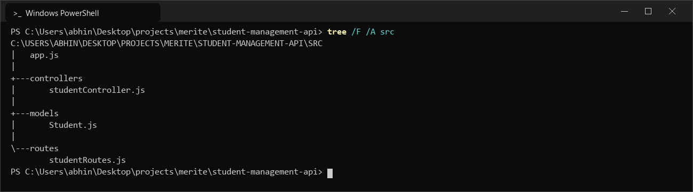

#### Student model (src/models/Student.js)

```javascript
const mongoose = require("mongoose");

const studentSchema = new mongoose.Schema(
  {
    name: { type: String, required: true },
    rollNo: { type: String, required: true, unique: true },
    email: { type: String, required: true },
    course: { type: String, required: true },
    year: { type: Number, min: 1, max: 5 },
  },
  { timestamps: true }
);

module.exports = mongoose.model("Student", studentSchema);
```

## End-to-end flow

```text
Developer ──git push──► GitHub ──triggers──► GitHub Actions pipeline
                                                │
                     ┌──────────────────────────┼───────────────────────────┐
                     ▼                          ▼                           ▼
              1. Test job                2. Docker job               3. Publish job (main only)
           Jest + MongoDB         docker compose up + curl       build & push image to GHCR
                                                                            │
                                                                            ▼
                                             Kubernetes pulls ghcr.io/.../student-api:latest
                                             and runs it as a scalable, self-healing Deployment
```

---

# Version Control using Git and GitHub

## Git and GitHub concepts

Git is a distributed version control system: it records every change to the code as a commit, so you can see history, compare versions, work on branches and undo mistakes. GitHub hosts Git repositories online and adds collaboration features such as pull requests, Actions (CI/CD) and Packages (container registry).

| Term | Meaning |
|---|---|
| Repository | The project folder plus its full history (.git). |
| Working directory / staging area | Files you edit / changes selected for the next commit (git add). |
| Commit | A saved snapshot with a message, author and unique hash. |
| Branch | An independent line of work; main is the default branch. |
| Merge | Combines the commits of one branch into another. |
| Remote (origin) | The copy of the repository on GitHub. |
| Push / Pull | Upload local commits to / download new commits from the remote. |

## Basic Git workflow

```powershell
git --version
```

Confirms Git is installed.

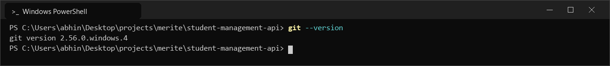

```powershell
git config user.name
```

Shows the author name recorded in commits (set once with git config --global user.name).

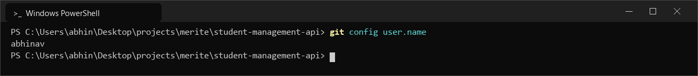

```powershell
git remote -v
```

The local repository is linked to the GitHub repository as origin.

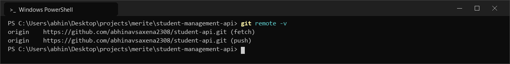

### git status: see what changed

```powershell
git status
```

The new k8s/ folder is untracked, meaning Git sees it but it is not part of any commit yet.

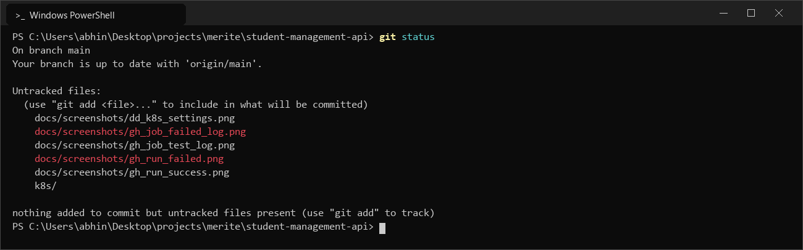

### git add: stage changes

```powershell
git add k8s/
```

Moves the new files into the staging area. It prints nothing on success.

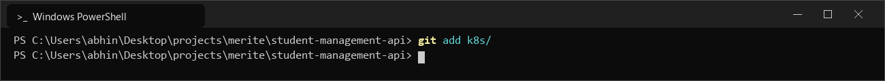

```powershell
git status --short
```

A = added to the staging area, ?? = still untracked.

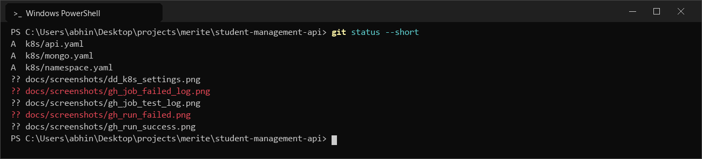

### git commit: save a snapshot

```powershell
git commit -m "..."
```

Creates a commit containing the staged files. a6e4d30 is its short hash.

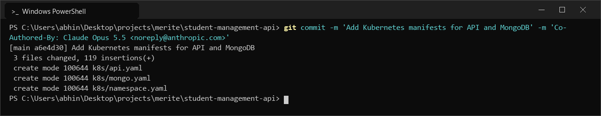

### git push: upload to GitHub

```powershell
git push origin main
```

Sends the new commit to GitHub. This push also triggers the CI/CD pipeline.

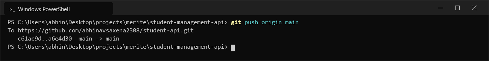

### git log and git branch: history

```powershell
git log --oneline --graph -8
```

Shows commit history as a graph, including the feature branch that was merged into main.

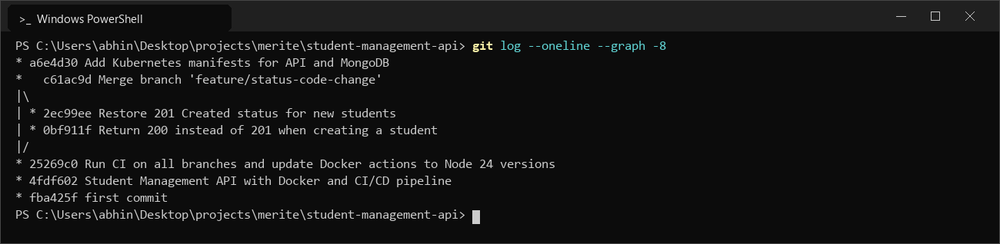

```powershell
git branch -a
```

Lists local branches and remote-tracking branches (remotes/origin/...).

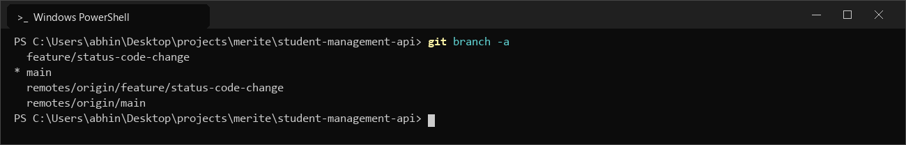

## Branching and merging workflow

New work is done on a feature branch, so main always stays working. In this project a feature branch was used to show how CI protects main:

- git switch -c feature/status-code-change: create and switch to a new branch
- Commit a change (the create endpoint now returns 200 instead of 201) and push the branch
- GitHub Actions runs the tests on the branch; they fail, so the problem is caught before main
- Commit a fix on the same branch and push; the pipeline passes
- git switch main and git merge --no-ff feature/status-code-change, then git push

```powershell
git show --stat 0bf911f
```

The commit that introduced the bug.

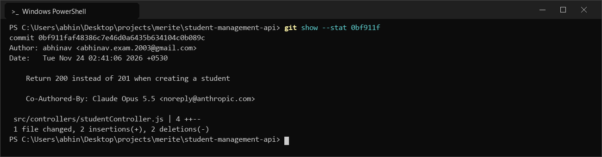

```powershell
git diff 0bf911f 2ec99ee -- src/controllers/studentController.js
```

The difference between the buggy commit and the fix: status 200 goes back to 201.

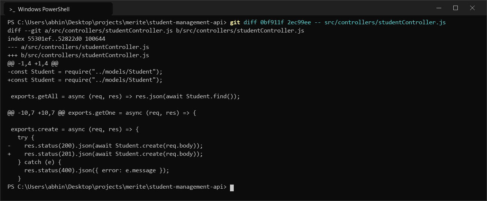

## The repository on GitHub

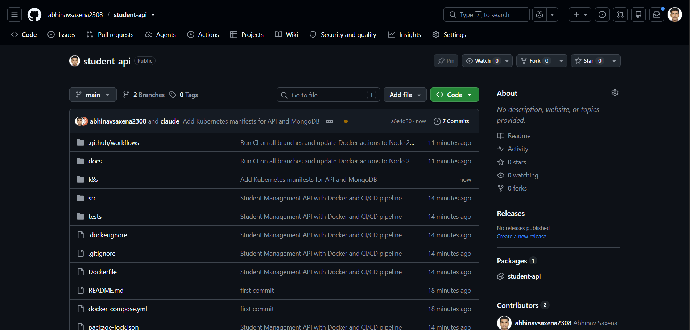

*GitHub repository page with the project files*

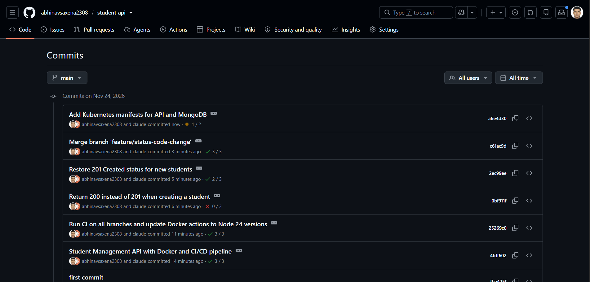

*Commit history on GitHub*

#### Git command reference

| Command | What it does |
|---|---|
| git init | Create a new repository |
| git clone <url> | Copy a remote repository |
| git status | Show changed, staged and untracked files |
| git add <files> / git add . | Stage changes |
| git commit -m "msg" | Commit staged changes |
| git push / git pull | Upload / download commits |
| git log --oneline --graph | Show history |
| git switch -c <branch> | Create and switch to a branch |
| git merge <branch> | Merge a branch into the current one |
| git diff | Show line-by-line changes |
| git remote -v | Show linked remotes |

---

# CI/CD using GitHub Actions

## GitHub Actions concepts

| Term | Meaning |
|---|---|
| Workflow | A YAML file in .github/workflows/ that defines the automation. |
| Event (on) | What starts the workflow: push, pull_request, manual run (workflow_dispatch). |
| Job | A group of steps that runs on one machine. Jobs can depend on each other (needs). |
| Step | A single command (run) or a reusable action (uses). |
| Runner | The virtual machine GitHub provides to run a job (ubuntu-latest). |
| Action | A reusable step, e.g. actions/checkout or docker/build-push-action. |
| Service container | An extra container for a job, e.g. MongoDB for the tests. |
| GITHUB_TOKEN | A temporary token GitHub creates for each run; used here to push to GHCR. |

## Automated tests

The pipeline is only useful if it can tell good code from bad code, so the project has API tests written with Jest and Supertest. They call every endpoint against a real MongoDB database.

```powershell
cat tests/api.test.js | Select-Object -First 30
```

The first part of the test file.

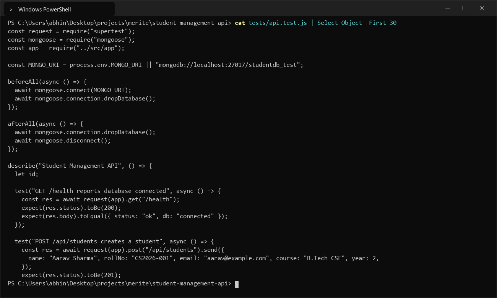

Running the tests locally against a temporary MongoDB container:

```powershell
docker run -d --rm --name test-mongo -p 27017:27017 mongo:7
```

Starts a throwaway MongoDB for the tests (--rm deletes it when stopped).

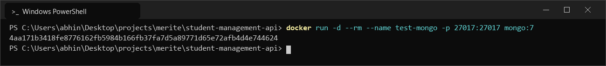

```powershell
npm test
```

All 6 tests pass.

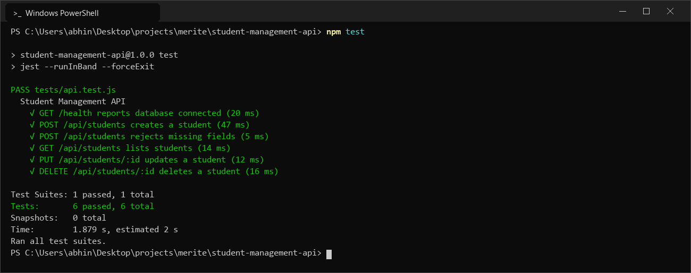

```powershell
docker stop test-mongo
```

Stops (and removes) the test database.


## The CI/CD workflow file

```powershell
tree /F /A .github
```

Workflows live in .github/workflows/.

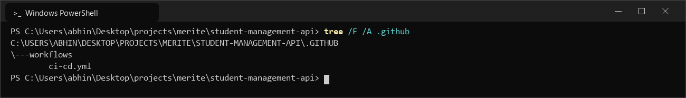

```powershell
cat .github/workflows/ci-cd.yml
```

The complete pipeline definition.

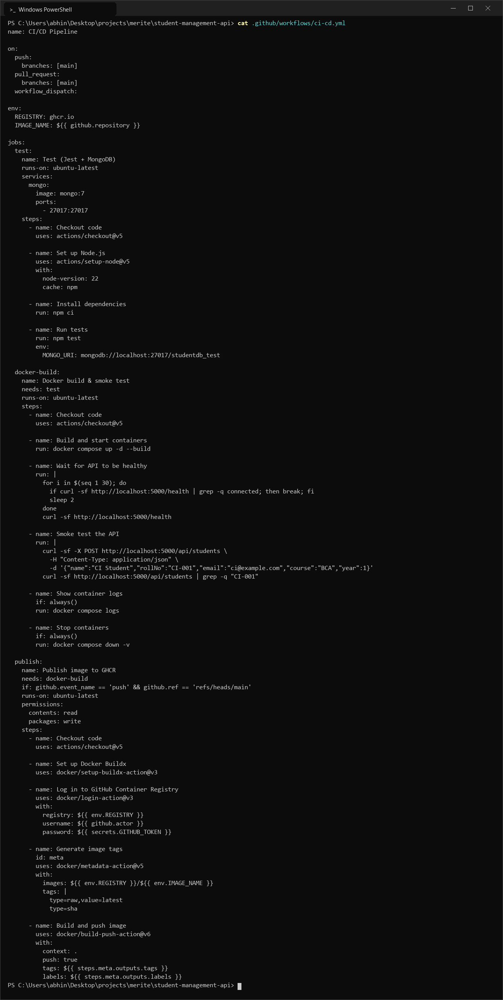

| Section | Purpose |
|---|---|
| on: push (all branches), pull_request, workflow_dispatch | Run on every push to any branch, on pull requests to main, and manually. |
| env: REGISTRY, IMAGE_NAME | Image is published as ghcr.io/<owner>/<repo>. |
| job test | Starts a MongoDB service container, installs dependencies with npm ci and runs npm test. |
| job docker-build (needs: test) | Runs only if tests pass. Builds the image and starts the whole stack with docker compose, waits for /health, then calls the API with curl. |
| if: always() steps | Container logs are printed and the stack is stopped even if a step failed. |
| job publish (needs: docker-build) | Runs only for pushes to main. Logs in to GHCR with GITHUB_TOKEN, generates tags and builds and pushes the image. |
| permissions: packages: write | Allows this job (and only this job) to publish packages. |
| tags: latest and sha-<commit> | latest always points to the newest main build; the sha tag identifies exactly which commit an image came from. |

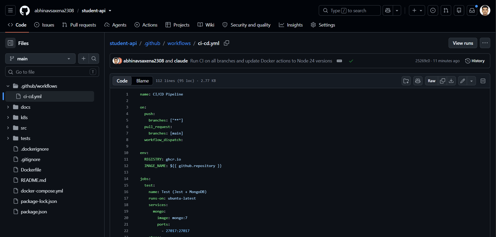

*The workflow file on GitHub*

## The pipeline in action

Every git push starts the pipeline automatically. The Actions tab lists all runs, with the branch and the result of each:

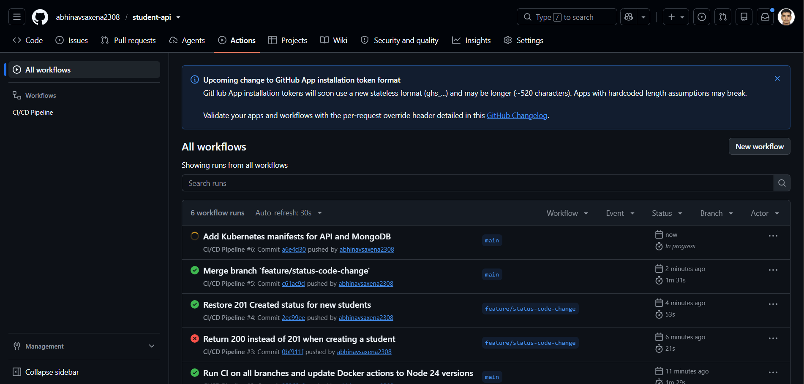

*Actions tab: runs on main and on the feature branch (one failed, the rest passed)*

### A successful run on main

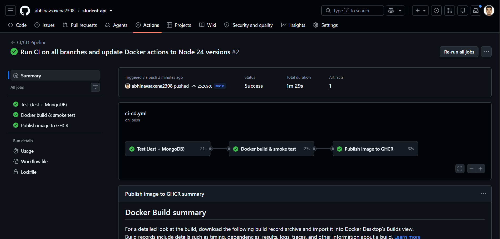

*Run summary: Test → Docker build & smoke test → Publish image to GHCR, all passed*

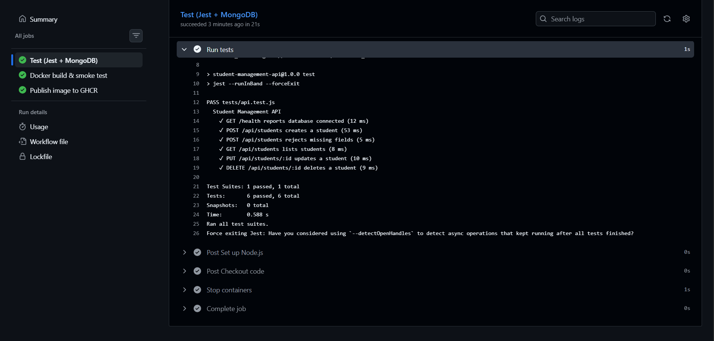

*Test job log: the 6 Jest tests passing on the GitHub runner*

### Continuous Delivery: the published image

The publish job pushed the image to GitHub Container Registry. The package is public, so anyone, including Kubernetes, can pull it:

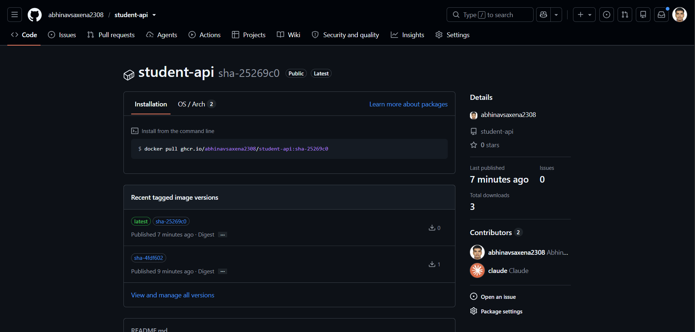

*GHCR package page with the latest and sha-<commit> tags*

```powershell
docker pull ghcr.io/abhinavsaxena2308/student-api:latest
```

### When the pipeline catches a bug

On the feature branch the create endpoint was changed to return 200 instead of 201. The push triggered the pipeline and the test job failed. Because the later jobs depend on it (needs: test), the Docker build and publish jobs were skipped, so no broken image was published.

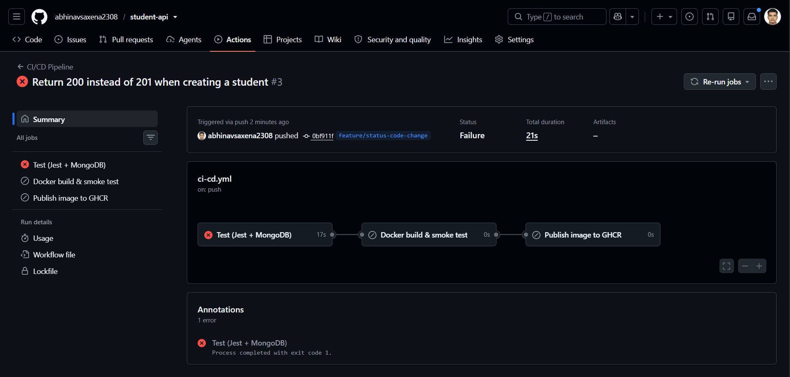

*Failed run: Test failed, Docker build and Publish were skipped*

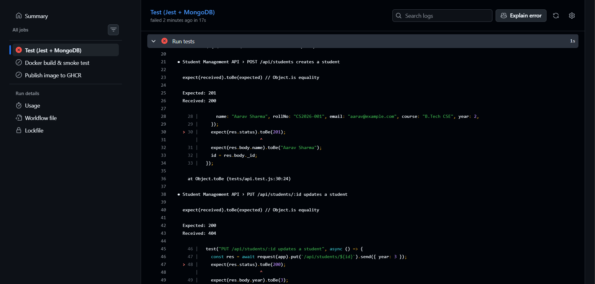

*Failed test log: expected status 201 but received 200*

After the fix was pushed the branch went green, and once it was merged the pipeline on main ran all three jobs and published a new image (see the Actions list above).

---

# Containerization and Orchestration

## Docker

Docker packages an application together with everything it needs (runtime, libraries, configuration) into an image. A running image is a container. Containers run the same way on a laptop, on a GitHub Actions runner and in a Kubernetes cluster.

| Term | Meaning |
|---|---|
| Image | A read-only template built from a Dockerfile. Example: student-api:1.0 |
| Container | A running instance of an image. Many containers can run from one image. |
| Dockerfile | Step-by-step instructions to build an image. |
| Registry | A store for images: Docker Hub, GHCR. |
| Volume | Persistent storage; data survives container removal. |
| Network | A virtual network that lets containers reach each other by name. |
| Docker Compose | Defines and runs multi-container apps from one YAML file. |

### Setup

```powershell
docker --version
```

Confirms the Docker CLI is installed.


```powershell
docker info
```

Engine details: containers, images, storage driver, kernel, CPUs and memory. (Server section shown.)

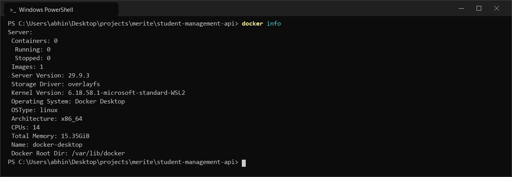

### The Dockerfile

```powershell
cat Dockerfile
```

The Dockerfile used to build the API image.


| Instruction | Purpose |
|---|---|
| FROM node:22-alpine | Base image: Node.js 22 on lightweight Alpine Linux. |
| WORKDIR /app | Working directory inside the image. |
| COPY package*.json ./ | Copy dependency manifests first so the install layer is cached. |
| RUN npm ci --omit=dev | Clean install of production dependencies from package-lock.json. |
| COPY src ./src | Copy the application source code. |
| ENV PORT=5000 / EXPOSE 5000 | Default port and documentation of the listening port. |
| CMD ["npm", "start"] | Command executed when a container starts. |

```powershell
cat .dockerignore
```

Files kept out of the build context (faster builds, smaller images).

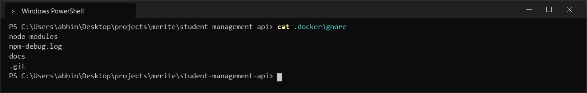

### Image commands

```powershell
docker pull node:22-alpine
```

Downloads the base image from Docker Hub.


```powershell
docker build -t student-api:1.0 .
```

-t names the image; . is the build context. Each Dockerfile instruction is a build step.

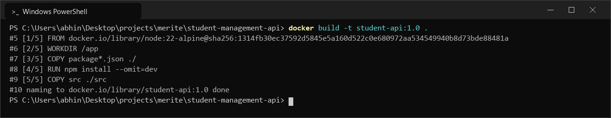

```powershell
docker images
```

Lists local images with tag, ID and size.


```powershell
docker tag student-api:1.0 student-api:latest
```

Adds a second tag to the same image.


```powershell
docker images student-api
```

Filters the list by repository name.

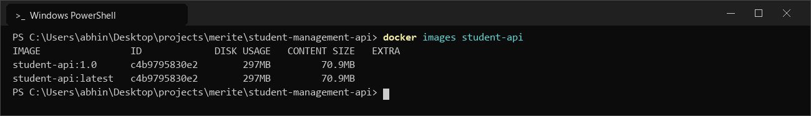

```powershell
docker history student-api:1.0
```

The layer created by each instruction. The top 7 rows come from our Dockerfile, the rest from the base image.

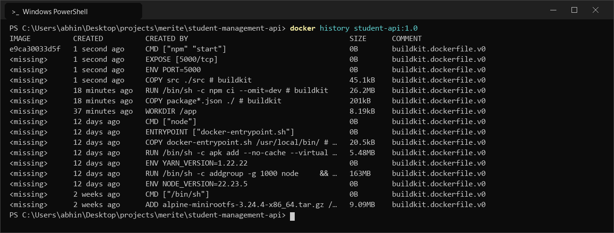

```powershell
docker inspect student-api:1.0 --format "..."
```

Low-level image metadata.

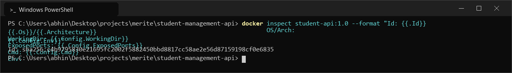


*Docker Desktop: Images view*

### Networks and volumes

```powershell
docker network create student-net
```

A user-defined network; containers on it resolve each other by name.

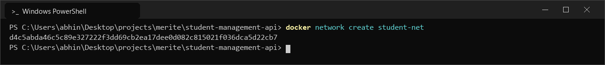

```powershell
docker network ls
```

Lists networks.

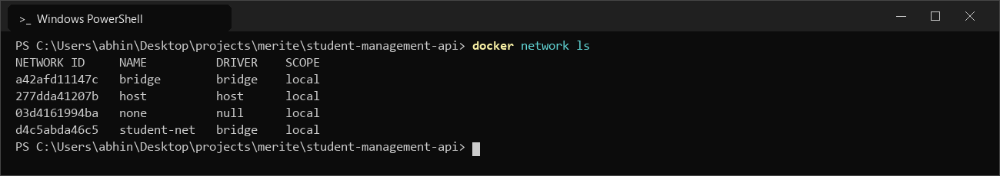

```powershell
docker volume create student-data
```

A named volume for MongoDB data.


```powershell
docker volume ls
```

Lists volumes.


### Container commands

```powershell
docker run -d --name student-mongo --network student-net -v student-data:/data/db mongo:7
```

-d detached, --name container name, --network attach to network, -v mount volume. The image is pulled automatically.


```powershell
docker run -d --name student-api --network student-net -p 5000:5000 -e MONGO_URI=mongodb://student-mongo:27017/studentdb student-api:1.0
```

-p maps host port to container port, -e sets an environment variable.

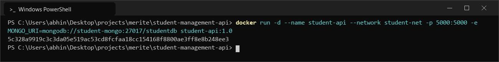

```powershell
docker ps
```

Running containers with status and ports.


```powershell
docker logs student-api
```

Container output (add -f to follow).

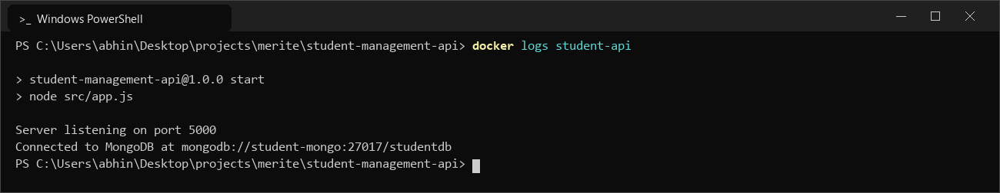

```powershell
curl -s -X POST http://localhost:5000/api/students ...
```

Create a student through the containerised API.


```powershell
curl -s http://localhost:5000/api/students
```

Read all students back.

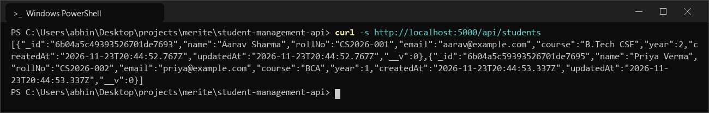

```powershell
docker exec student-api sh -c "..."
```

Run commands inside a running container.

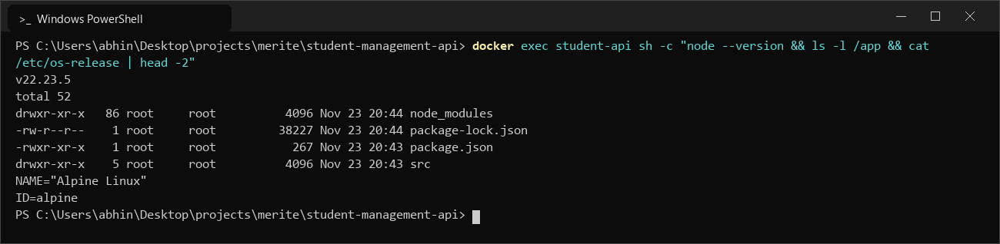

```powershell
docker exec student-mongo mongosh studentdb --eval "..."
```

Query MongoDB inside its container.

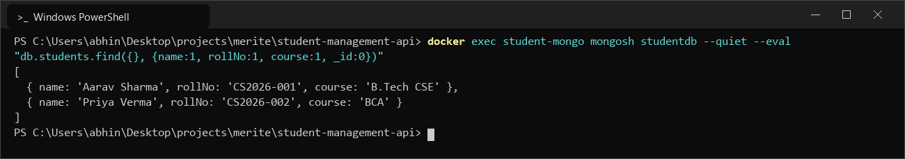

```powershell
docker top student-api
```

Processes inside the container.

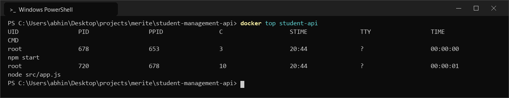

```powershell
docker stats --no-stream
```

CPU, memory, network and disk usage.

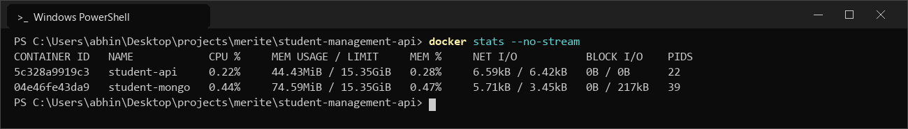

```powershell
docker stop student-api
```

Gracefully stop a container.


```powershell
docker ps -a
```

All containers including stopped ones.

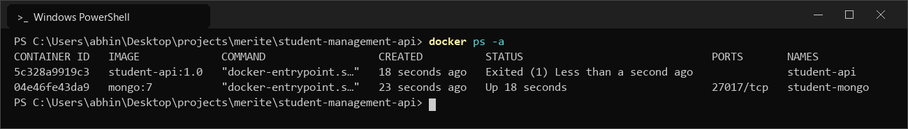

```powershell
docker start student-api
```

Start it again.

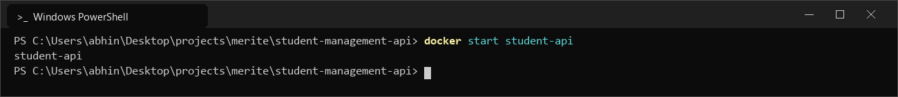

```powershell
docker restart student-api
```

Stop and start in one step.

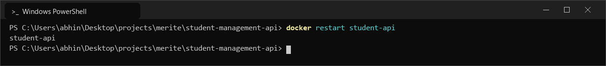

```powershell
docker network inspect student-net --format "..."
```

Containers attached to the network and their IPs.

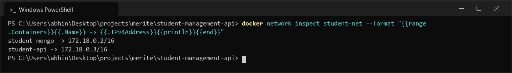

```powershell
docker volume inspect student-data
```

Volume details and mount point.

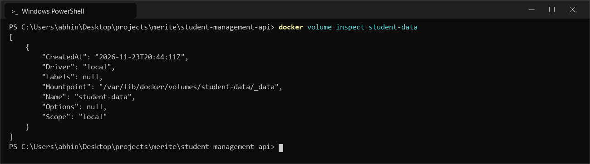

```powershell
docker rm -f student-api student-mongo
```

Remove containers (data stays in the volume).


```powershell
docker network rm student-net
```

Remove the network.

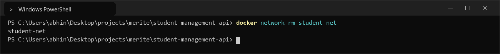

### Docker Compose

Compose describes the API, database, network and volume in one YAML file and starts everything with one command. The same file is used by the GitHub Actions smoke test.

```powershell
cat docker-compose.yml
```

The project's compose file.

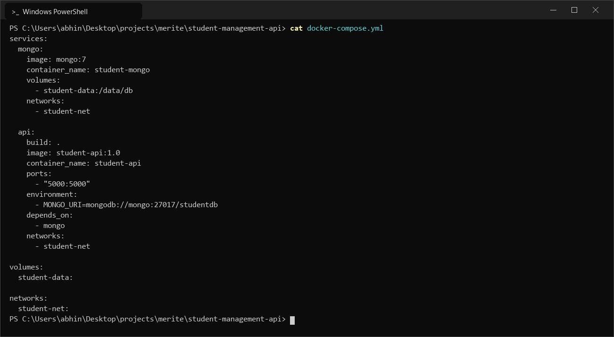

| Key | Purpose |
|---|---|
| services | The containers: mongo (database) and api (backend). |
| image / build | mongo uses a ready image; api is built from the local Dockerfile. |
| ports | Publishes container port 5000 on host port 5000. |
| environment | MONGO_URI uses the service name mongo as the hostname. |
| depends_on | Starts mongo before api. |
| volumes / networks | Persistent database storage and a private network. |

```powershell
docker compose up -d --build
```

Build and start the whole stack in the background.

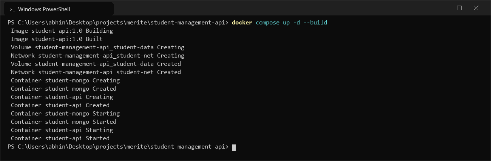

```powershell
docker compose ps
```

Containers of this compose project.


```powershell
docker compose logs api
```

Logs of the api service.


```powershell
curl -s http://localhost:5000/health
```

The API is connected to MongoDB.


*Docker Desktop: the compose stack with student-mongo and student-api*


*Docker Desktop: logs of the student-api container*


*Docker Desktop: live CPU, memory, disk and network stats*


*Docker Desktop: volumes*


*Docker Desktop: build history*

```powershell
docker compose down
```

Stop and remove the stack (add -v to delete volumes).


### Docker cleanup

```powershell
docker rmi student-api:latest
```

Remove an image tag.


```powershell
docker system df
```

Disk used by images, containers, volumes and cache.


```powershell
docker image prune -f
```

Delete dangling images.


```powershell
docker volume rm student-data
```

Delete a volume and its data.


## Kubernetes

Docker runs containers on one machine. Kubernetes runs containers across a cluster of machines and keeps them in the state you declare: if you ask for 4 copies of the API, it starts 4, restarts any that crash, replaces any that are deleted and balances traffic between them.

| Object | Meaning |
|---|---|
| Cluster / Node | A set of machines (nodes) managed by Kubernetes. Here: one node in Docker Desktop. |
| Pod | The smallest unit: one or more containers running together. |
| Deployment | Declares which image to run and how many replicas; handles rollouts and self-healing. |
| ReplicaSet | Created by a Deployment to keep the requested number of pods running. |
| Service | A stable name and IP that load-balances traffic to matching pods. |
| ConfigMap | Configuration (environment variables) kept outside the image. |
| PersistentVolumeClaim | A request for persistent storage (used by MongoDB). |
| Namespace | A logical group that isolates this app's objects (student-app). |
| kubectl | The command-line tool used to talk to the cluster. |

### Enabling Kubernetes in Docker Desktop

Settings → Kubernetes → Enable Kubernetes → Apply → Install. Docker Desktop created a single-node cluster (kind provisioner, Kubernetes v1.36.1).


*Docker Desktop Kubernetes settings*

```powershell
kubectl version
```

kubectl client and cluster server versions.


```powershell
kubectl cluster-info
```

Address of the cluster's control plane.


```powershell
kubectl get nodes -o wide
```

The cluster has one Ready node.


### Kubernetes manifests

The desired state is written as YAML in the k8s/ folder. The API Deployment uses the image that GitHub Actions published to GHCR, which connects the CI/CD pipeline to the deployment.

```powershell
cat k8s/mongo.yaml
```

MongoDB: a PersistentVolumeClaim for data, a Deployment with 1 replica and a ClusterIP Service named mongo.


```powershell
cat k8s/api.yaml
```

API: a ConfigMap with MONGO_URI, a Deployment with 2 replicas of the GHCR image, health probes and resource limits, and a NodePort Service.


| Setting | Purpose |
|---|---|
| replicas: 2 | Run two identical API pods. |
| image: ghcr.io/.../student-api:latest | The image built and published by the CI/CD pipeline. |
| envFrom: configMapRef | Injects MONGO_URI and PORT from the ConfigMap. |
| readinessProbe /health | A pod only receives traffic once /health responds. |
| livenessProbe /health | Kubernetes restarts the container if /health stops responding. |
| resources requests / limits | Guaranteed and maximum CPU/memory per pod. |
| Service selector app: student-api | Sends traffic to all pods with that label. |

### Deploying the application

```powershell
kubectl apply -f k8s/namespace.yaml
```

Create the student-app namespace.


```powershell
kubectl apply -f k8s/
```

Create every object defined in the folder.


```powershell
kubectl rollout status deployment/student-api -n student-app
```

Waits until all replicas are available.


```powershell
kubectl get all -n student-app
```

Pods, services, deployments and replicasets of the app.


```powershell
kubectl get pods -n student-app -o wide
```

Pods with their internal IP and node.


```powershell
kubectl describe deployment student-api -n student-app
```

Full details of the deployment: image, probes, limits, rollout strategy and events.


```powershell
kubectl logs deployment/student-api -n student-app
```

Logs from an API pod: connected to MongoDB.


### Accessing the application

```powershell
kubectl port-forward svc/student-api 8080:80 -n student-app
```

Forwards localhost:8080 to the service inside the cluster (left running in its own terminal).


```powershell
curl -s http://localhost:8080/health
```

The API running in Kubernetes is healthy.


```powershell
curl -s -X POST http://localhost:8080/api/students ...
```

Create a student in the Kubernetes deployment.


```powershell
curl -s http://localhost:8080/api/students
```

Read it back from MongoDB running in the cluster.


### Scaling

```powershell
kubectl scale deployment student-api --replicas=4 -n student-app
```

Scale the API from 2 to 4 pods.


```powershell
kubectl get pods -n student-app -l app=student-api
```

Two new pods were started.


### Self-healing

```powershell
kubectl delete pod <pod-name> -n student-app
```

Delete one pod on purpose.


```powershell
kubectl get pods -n student-app -l app=student-api
```

Kubernetes immediately created a replacement pod (age a few seconds) to keep 4 replicas.


```powershell
kubectl rollout history deployment/student-api -n student-app
```

Revision history; kubectl rollout undo can return to an earlier revision.


```powershell
kubectl get configmap,pvc -n student-app
```

The ConfigMap and the bound storage claim.


*Docker Desktop: Kubernetes view of the student-app namespace*

### Kubernetes cleanup

```powershell
kubectl delete -f k8s/
```

Deletes everything that was created from the manifests.


```powershell
kubectl get namespaces
```

The student-app namespace is gone.


---

# Summary

## Command cheat sheet

| Area | Command | What it does |
|---|---|---|
| Git | git add / commit / push | Stage, commit and upload changes |
| Git | git switch -c / merge | Create a branch / merge it |
| Git | git log --oneline --graph | View history |
| Actions | .github/workflows/*.yml | Define the pipeline |
| Actions | on: push / pull_request | Run on every push / PR |
| Actions | needs: <job> | Run a job only after another succeeds |
| Docker | docker build -t name:tag . | Build an image |
| Docker | docker run -d -p h:c --name n img | Run a container |
| Docker | docker ps / logs / exec / stop / rm | Manage containers |
| Docker | docker compose up -d / down | Start / stop a multi-container stack |
| Kubernetes | kubectl apply -f <dir> | Create or update objects from YAML |
| Kubernetes | kubectl get pods / all | List resources |
| Kubernetes | kubectl describe / logs | Inspect a resource / read logs |
| Kubernetes | kubectl scale --replicas=N | Scale a deployment |
| Kubernetes | kubectl port-forward svc/x 8080:80 | Reach a service locally |
| Kubernetes | kubectl delete -f <dir> | Remove the app |

## Conclusion

The Student Management API went through a complete DevOps workflow. Its code is versioned with Git and hosted on GitHub, using feature branches and merges. Every push runs a GitHub Actions pipeline that tests the code, builds and smoke-tests the Docker stack, and publishes a versioned image to GitHub Container Registry. A deliberate bug showed the pipeline blocking a broken change. The published image was then deployed to Kubernetes, where it was scaled, accessed, and automatically healed after a pod was deleted.
