# Docker Basics: Hands-on Documentation

*Containerising a Student Management Backend (Node.js + Express + MongoDB)*

## Introduction

Docker is a platform that packages an application together with everything it needs (runtime, libraries, configuration) into a portable unit called a container. A container runs the same way on any machine that has Docker installed, which removes the classic "it works on my machine" problem.

#### Core concepts

| Term | Meaning |
|---|---|
| Image | A read-only template (blueprint) built from a Dockerfile. Example: student-api:1.0 |
| Container | A running instance of an image. Many containers can run from one image. |
| Dockerfile | A text file with step-by-step instructions to build an image. |
| Registry | A store for images. Docker Hub is the default public registry. |
| Volume | Persistent storage managed by Docker; data survives container removal. |
| Network | A virtual network that lets containers talk to each other by name. |
| Docker Compose | A tool to define and run multi-container apps from one YAML file. |

## Prerequisites and Setup

- Windows 11 with Docker Desktop installed (WSL 2 backend)
- PowerShell terminal
- Docker Engine 29.9.3, Docker Compose v5.7.1, Docker Desktop 4.100.1

```powershell
docker --version
```

Confirms the Docker CLI is installed and prints its version.

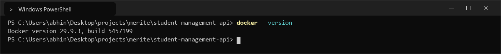

```powershell
docker info
```

Shows system-wide information about the Docker engine: number of containers and images, storage driver, kernel, CPUs and memory available to Docker. (Server section shown.)


## Project Overview: Student Management API

A small REST API that performs CRUD operations on student records. It is written in Node.js with Express, and stores data in MongoDB through Mongoose.

| Method | Endpoint | Description |
|---|---|---|
| GET | /api/students | List all students |
| GET | /api/students/:id | Get a single student |
| POST | /api/students | Create a student |
| PUT | /api/students/:id | Update a student |
| DELETE | /api/students/:id | Delete a student |
| GET | /health | API and database health check |

#### Folder structure

```text
student-management-api/
├── src/
│   ├── app.js
│   ├── controllers/studentController.js
│   ├── models/Student.js
│   └── routes/studentRoutes.js
├── package.json
├── Dockerfile
├── .dockerignore
├── docker-compose.yml
└── docs/  (this documentation + screenshots)
```

```powershell
tree /F /A src
```

Source code layout as seen in the terminal.


#### Student model (src/models/Student.js)

```javascript
const mongoose = require("mongoose");

const studentSchema = new mongoose.Schema(
  {
    name: { type: String, required: true },
    rollNo: { type: String, required: true, unique: true },
    email: { type: String, required: true },
    course: { type: String, required: true },
    year: { type: Number, min: 1, max: 5 },
  },
  { timestamps: true }
);

module.exports = mongoose.model("Student", studentSchema);
```

## Writing the Dockerfile

```powershell
cat Dockerfile
```

The Dockerfile used to build the API image.

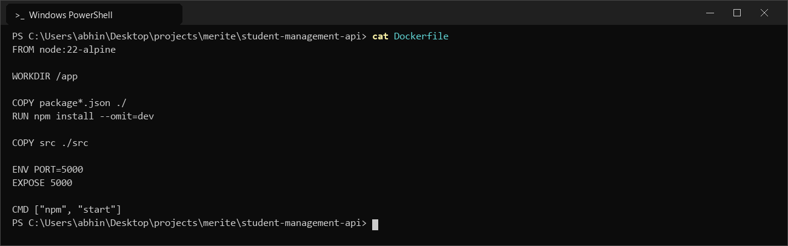

| Instruction | Purpose |
|---|---|
| FROM node:22-alpine | Base image: Node.js 22 on lightweight Alpine Linux. |
| WORKDIR /app | Sets /app as the working directory inside the image. |
| COPY package*.json ./ | Copies dependency manifests first so the npm install layer is cached. |
| RUN npm install --omit=dev | Installs production dependencies. |
| COPY src ./src | Copies the application source code. |
| ENV PORT=5000 | Default environment variable read by the app. |
| EXPOSE 5000 | Documents the port the app listens on. |
| CMD ["npm", "start"] | Command executed when a container starts. |

The .dockerignore file keeps unnecessary files out of the build context, which makes builds faster and images smaller:

```powershell
cat .dockerignore
```

Files excluded from the build context.


## Image Commands

### docker pull: download an image

```powershell
docker pull node:22-alpine
```

Downloads the base image from Docker Hub. Each image is made of layers, which are downloaded separately and reused across images.

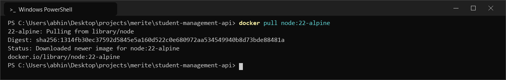

### docker build: build an image from a Dockerfile

```powershell
docker build -t student-api:1.0 .
```

-t gives the image a name:tag, and . is the build context (current folder). Each Dockerfile instruction becomes a build step [n/5].


### docker images: list local images

```powershell
docker images
```

Lists every image stored locally with its tag, ID and size.

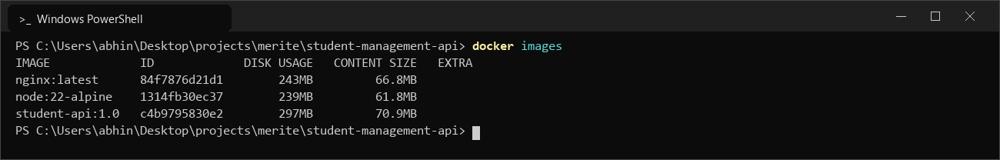

### docker tag: add another name to an image

```powershell
docker tag student-api:1.0 student-api:latest
```

Creates a second tag pointing to the same image. It prints nothing on success.

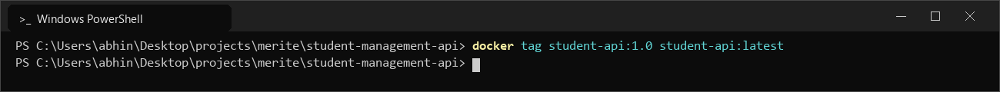

```powershell
docker images student-api
```

Filters the list by repository name. Both tags share the same IMAGE ID.


### docker history: view image layers

```powershell
docker history student-api:1.0
```

Shows the layer created by each Dockerfile instruction and its size. The top seven rows come from our Dockerfile; the rest come from the node:22-alpine base image.


### docker inspect: low-level image details

```powershell
docker inspect student-api:1.0 --format "..."
```

Returns the image metadata as JSON. --format with a Go template picks out specific fields.


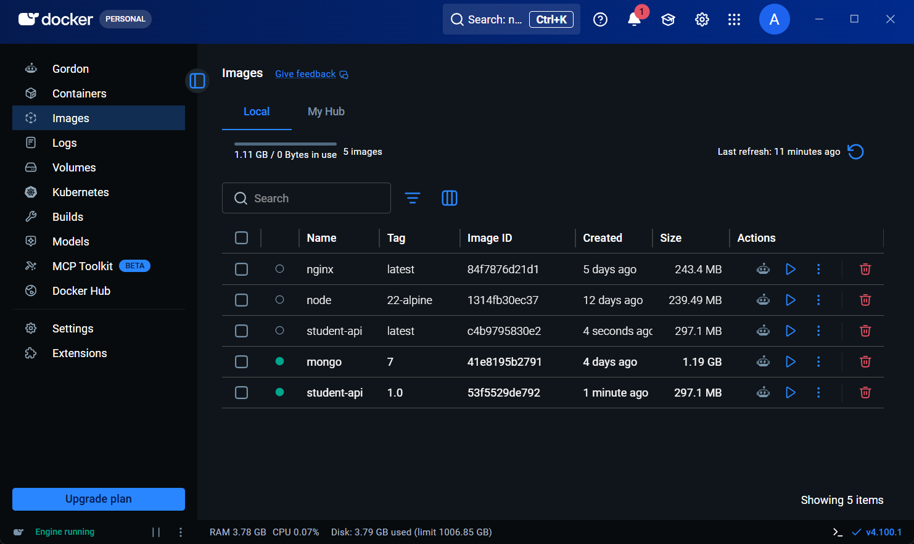

*Docker Desktop: Images view showing student-api, mongo and node images*

## Networks and Volumes

### Create a network

```powershell
docker network create student-net
```

Creates a user-defined bridge network. Containers on it can reach each other by container name.


```powershell
docker network ls
```

Lists networks (bridge, host and none are built in).


### Create a volume

```powershell
docker volume create student-data
```

Creates a named volume used to persist MongoDB data.

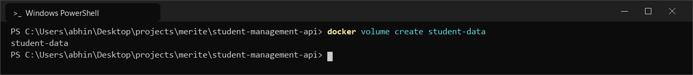

```powershell
docker volume ls
```

Lists volumes.

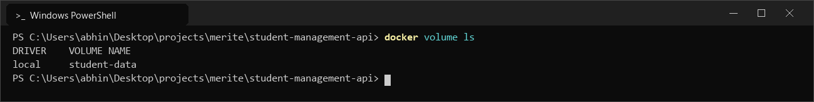

## Container Commands

### docker run: start the MongoDB container

```powershell
docker run -d --name student-mongo --network student-net -v student-data:/data/db mongo:7
```

-d runs in the background (detached), --name sets the container name, --network attaches it to student-net and -v mounts the volume. The image is pulled automatically because it is not present locally. The long string printed last is the container ID.

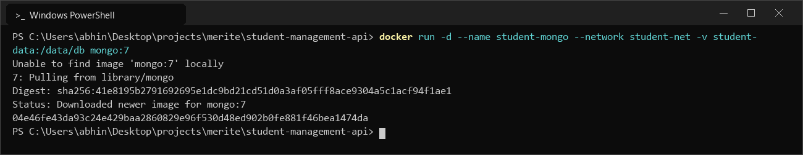

### docker run: start the API container

```powershell
docker run -d --name student-api --network student-net -p 5000:5000 -e MONGO_URI=mongodb://student-mongo:27017/studentdb student-api:1.0
```

-p 5000:5000 maps host port to container port and -e sets an environment variable. The API reaches MongoDB using the hostname student-mongo, which is the container name on the shared network.


### docker ps: list running containers

```powershell
docker ps
```

Shows running containers, their status and port mappings.

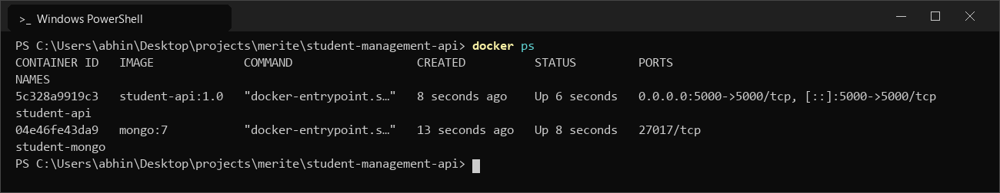

### docker logs: view container output

```powershell
docker logs student-api
```

Prints what the container wrote to stdout/stderr. Add -f to follow live.


### Testing the API running in the container

```powershell
curl -s -X POST http://localhost:5000/api/students ...
```

Creates a student through the containerised API.

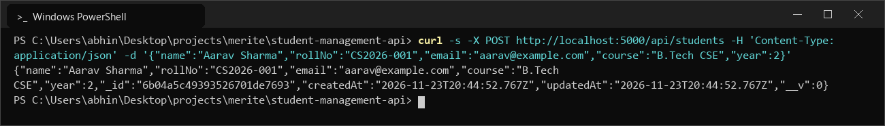

```powershell
curl -s -X POST http://localhost:5000/api/students ...
```

Creates a second student.

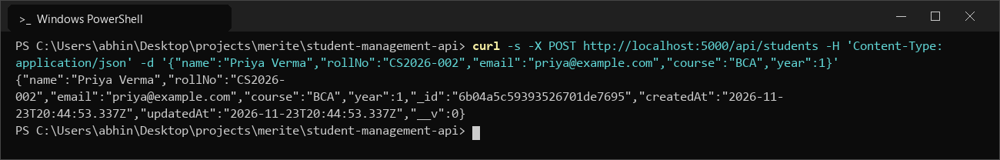

```powershell
curl -s http://localhost:5000/api/students
```

Fetches all students. The data is stored in the MongoDB container.


### docker exec: run a command inside a container

```powershell
docker exec student-api sh -c "..."
```

Runs commands inside the running API container: Node version, app files and OS (Alpine). Use docker exec -it student-api sh for an interactive shell.


```powershell
docker exec student-mongo mongosh studentdb --eval "..."
```

Queries MongoDB directly inside its container to confirm the records were saved.


### docker top and docker stats: monitor containers

```powershell
docker top student-api
```

Lists the processes running inside the container.


```powershell
docker stats --no-stream
```

Shows live CPU, memory, network and disk usage. --no-stream prints one snapshot.


### docker stop, start, restart

```powershell
docker stop student-api
```

Gracefully stops a running container.


```powershell
docker ps -a
```

-a lists all containers including stopped ones; student-api now shows Exited.


```powershell
docker start student-api
```

Starts the stopped container again.


```powershell
docker restart student-api
```

Stops and starts the container in one step.


### Inspecting the network and volume

```powershell
docker network inspect student-net --format "..."
```

Shows which containers are attached to the network and their internal IP addresses.


```powershell
docker volume inspect student-data
```

Shows volume details, including where Docker stores the data (Mountpoint).


### docker rm and docker network rm

```powershell
docker rm -f student-api student-mongo
```

Removes containers; -f stops them first if they are running. The data stays in the volume.

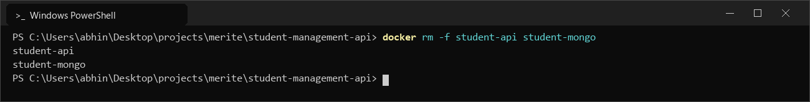

```powershell
docker network rm student-net
```

Removes the network.


## Docker Compose

Running each container by hand needs many flags. Docker Compose describes the whole stack (API, database, network and volume) in one YAML file and starts it with a single command.

### The project's docker-compose.yml

```powershell
cat docker-compose.yml
```

The compose file of the project.


| Key | Purpose |
|---|---|
| services | Defines the containers: mongo (database) and api (our backend). |
| image / build | mongo uses a ready image; api is built from the local Dockerfile (build: .). |
| container_name | Fixed container names (student-mongo, student-api). |
| ports | Publishes container port 5000 on host port 5000. |
| environment | MONGO_URI uses the service name mongo as the hostname. |
| depends_on | Starts mongo before api. |
| volumes | Named volume student-data persists the database files. |
| networks | Both services join student-net so they can talk to each other. |

### docker compose up

```powershell
docker compose up -d --build
```

Builds the API image, creates the network and volume, and starts both containers in the background. Build log lines are trimmed in the screenshot.


### docker compose ps and logs

```powershell
docker compose ps
```

Lists the containers of this compose project.

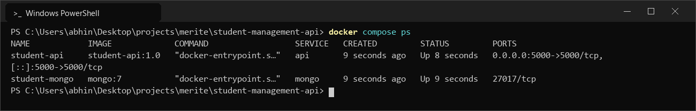

```powershell
docker compose logs api
```

Shows logs of the api service.


```powershell
curl -s -X POST http://localhost:5000/api/students ...
```

The API works the same way when started through Compose.


```powershell
curl -s http://localhost:5000/health
```

Health endpoint confirms the API is connected to MongoDB.

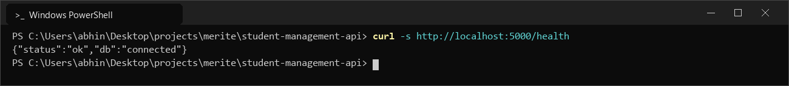

## Docker Desktop

Docker Desktop is the graphical interface for everything done above. The screenshots below were taken while the compose stack was running.

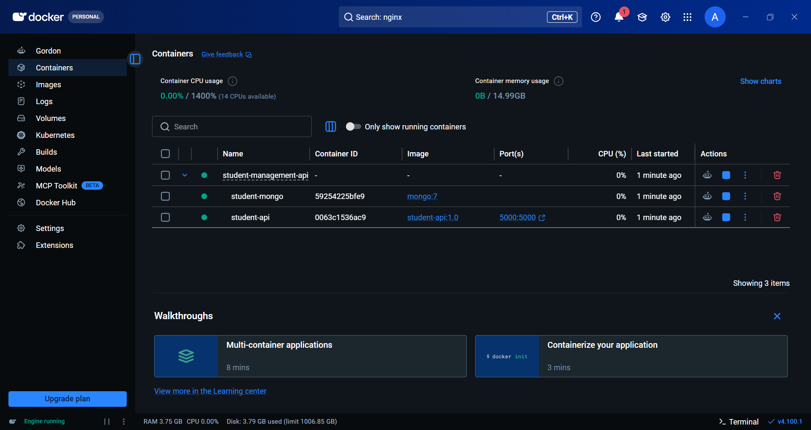

*Containers view: the student-management-api compose stack with student-mongo and student-api*


*Container details: logs of student-api*

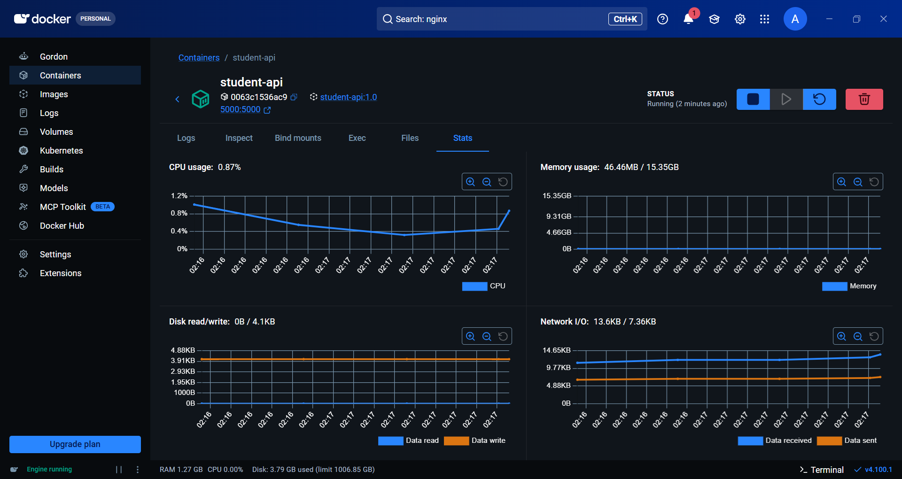

*Container details: live CPU, memory, disk and network stats*

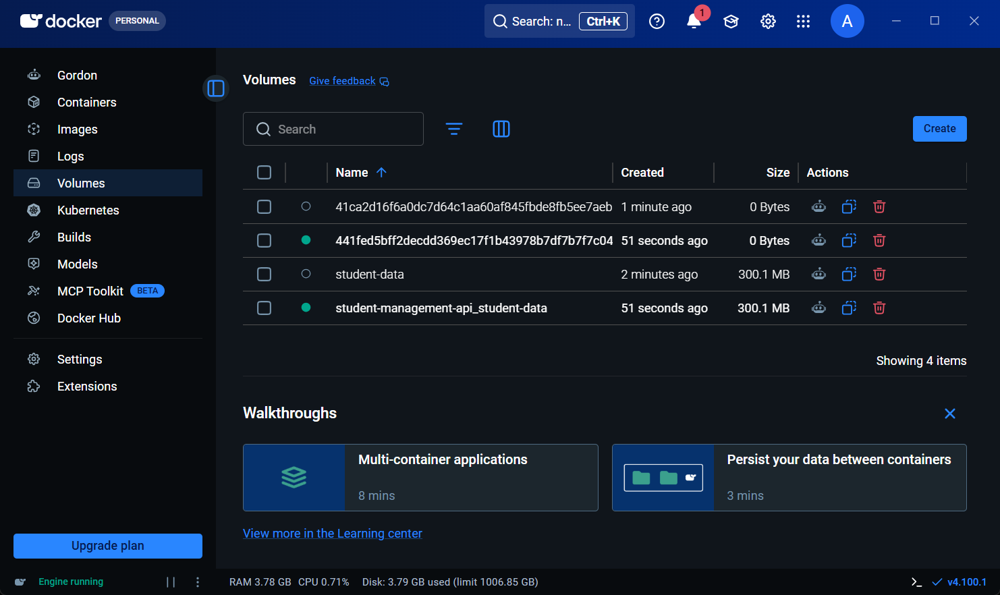

*Volumes view: student-data and the compose-managed volume*


*Builds view: build history for student-management-api*

## Pushing to Docker Hub (optional)

To share the image, tag it with your Docker Hub username and push it. These commands are listed for reference and need your own Docker Hub account:

```powershell
docker login
docker tag student-api:1.0 <your-dockerhub-username>/student-api:1.0
docker push <your-dockerhub-username>/student-api:1.0
```

## Cleanup

```powershell
docker compose down
```

Stops and removes the compose containers and network. Add -v to also delete volumes.


```powershell
docker rmi student-api:latest
```

Removes an image tag.

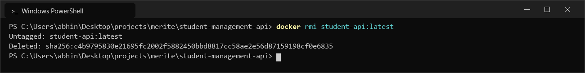

```powershell
docker system df
```

Shows disk space used by images, containers, volumes and cache.

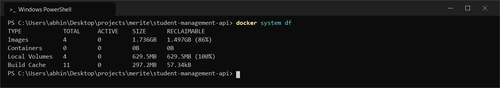

```powershell
docker image prune -f
```

Deletes dangling (untagged) images.


```powershell
docker volume rm student-data
```

Deletes a volume and its data.


docker system prune removes all stopped containers, unused networks, dangling images and build cache in one go. Use it carefully, because it also affects other projects.

## Command Cheat Sheet

| Command | What it does |
|---|---|
| docker --version / docker info | Check installation and engine details |
| docker pull <image> | Download an image |
| docker build -t name:tag . | Build an image from a Dockerfile |
| docker images | List images |
| docker tag src dst | Add a new tag to an image |
| docker history / inspect | Show image layers / metadata |
| docker rmi <image> | Remove an image |
| docker run -d -p h:c --name n img | Create and start a container |
| docker ps / docker ps -a | List running / all containers |
| docker logs [-f] <container> | Show container output |
| docker exec -it <container> sh | Open a shell inside a container |
| docker top / docker stats | Processes / resource usage |
| docker stop \| start \| restart | Control container lifecycle |
| docker rm [-f] <container> | Remove a container |
| docker network create \| ls \| inspect \| rm | Manage networks |
| docker volume create \| ls \| inspect \| rm | Manage volumes |
| docker compose up -d --build | Build and start all services |
| docker compose ps \| logs \| down | Inspect and stop a compose project |
| docker system df / prune | Disk usage / cleanup |
| docker login / push | Publish an image to a registry |

## Conclusion

The Student Management API was containerised with a Dockerfile, run as two connected containers (API and MongoDB) using a custom network and a persistent volume, and then started as a single stack with Docker Compose. Every basic Docker command for images, containers, networks, volumes, Compose and cleanup was executed and verified, both from the terminal and in Docker Desktop.
